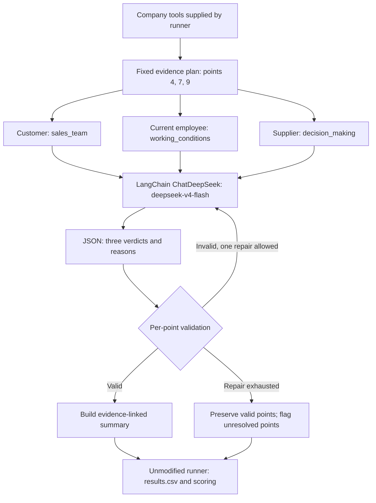

[Jump to the solution](#homework-3-solution)

# FTEC5660 Homework 3: Fisher's 15-Point Investment Agent

Build a LangChain agent that researches a company with tools and applies the
framework from Philip Fisher's *Common Stocks and Uncommon Profits* (Part One,
Chapter 3 "What to buy: the fifteen points to look for in a common stock", and
Chapter 4 "What to buy: applying this to your own needs"). You choose 3 of
Fisher's 15 points and decide yourself what PASS means for each. For every
company your agent gives a PASS/FAIL verdict on your 3 points and a short
summary.

The companies are fictional, so the model cannot answer from memory. Unlike a
pile of reports, the evidence is spread over three sources, and your agent has
to go and get it with tools, the way Fisher's "scuttlebutt" method sends an
investor to talk to customers, competitors, suppliers and staff.

## Data and tools

`public_test/` has one folder per company. Your code receives four tools per
company (built by the provided code in `hw3.py`):

| Tool | What it gives you |
| --- | --- |
| `list_documents()` | the company's six documents and their dates |
| `read_document(name)` | one document: the 2025 letter to shareholders, four earnings calls (Q3 2025 to Q2 2026) and a news file (July 2025 to July 2026) |
| `sql_query(query)` | one read-only SQLite query on the company's database; at most 50 rows come back, so use `SUM`, `GROUP BY` and `WHERE` |
| `interview(role, topic)` | what one person says about the company; at most **10 interviews per company** |

The documents are what management says. Management's own claims (such as "we
have never cut research" or "our people are our greatest strength") are not
evidence on their own: check them against the database and the interviews.

**Database tables** (amounts in USD thousands; dates `YYYY-MM-DD`, months
`YYYY-MM`, quarters like `2025Q3`; the fiscal year is the calendar year):

| Table | Columns |
| --- | --- |
| `company` | name, industry |
| `industry_medians` | industry, revenue_growth_2y_pct, new_product_share_pct, new_product_sales_per_rd, operating_margin_pct (one row per industry; use the row for the company's own industry) |
| `orders` | order_id, order_date, product, customer, amount, note (about 3,000 to 4,000 orders from January 2023 to June 2026; revenue is the sum of order amounts) |
| `products` | product, launch_date |
| `monthly_costs` | month, cost_of_sales, selling_admin, research_development |
| `quarterly_cash` | quarter, operating_cash_flow, capex, cash_end |
| `capex_plan` | year, planned_capex (2026 to 2028) |
| `returns` | month, units_shipped, units_returned |
| `insider_trades` | trade_date, person, title, side (`buy` or `sell`), shares, price |

**Terms used in the data.**

| Term | Meaning |
| --- | --- |
| FY2025 | Fiscal year 2025. Here the fiscal year is the calendar year, so FY2025 is January to December 2025. |
| Quarter | Three months of the year: Q1 is January to March, Q2 April to June, Q3 July to September and Q4 October to December. The database writes `2025Q3`; the documents write "third quarter 2025". |
| Amounts | The database is in **USD thousands** (676,100 means US$676.1 million). The documents use USD millions. |
| Revenue | Money from sales: the sum of `amount` in `orders`. |
| Cost of sales | The cost of making the products that were sold. |
| Selling and admin | The cost of selling and of running the company (sales staff, offices, management). |
| R&D | Research and development spending, mainly on new products. |
| Operating margin | Operating profit as a share of revenue: (revenue − cost of sales − selling and admin − R&D) ÷ revenue. |
| Operating cash flow | Cash that the day-to-day business brings in during a quarter. |
| Cash at the end of a quarter | The cash the company holds on the last day of that quarter (`cash_end`). |
| Capex | Capital expenditure: spending on factories, machines and other long-term assets. `capex_plan` holds the planned capex for 2026 to 2028. |
| Return rate | Units returned ÷ units shipped, from the `returns` table. |
| Industry median | The middle value for companies in the same industry, from `industry_medians`. |
| Insider | A director or senior manager of the company. `insider_trades` lists the shares they bought (`buy`) or sold (`sell`). |
| Earnings call | A meeting each quarter where management presents the quarter's results to investors. Each call quotes that quarter's revenue. |

**Interviews.** Roles: `customer`, `current_employee`, `former_employee`,
`competitor`, `supplier`. Topics: `sales_team`, `working_conditions`,
`top_management`, `decision_making`, `competitive_edge`. Only some people know
about each topic; the others say they can't comment, and that answer still
uses up one interview.

| Topic | Who knows about it |
| --- | --- |
| `sales_team` | customer, competitor |
| `working_conditions` | current_employee, former_employee |
| `top_management` | former_employee, supplier |
| `decision_making` | supplier, customer |
| `competitive_edge` | competitor, customer |

People who know about a topic always agree with each other, so one good answer
is enough.

## Choose your 3 points and your rules

Pick any 3 of Fisher's 15 points and write them in `CHOSEN_POINTS` near the
top of `hw3.py`, e.g. `CHOSEN_POINTS = [1, 7, 15]`. The full questions are in
`FISHER_POINTS` in `hw3.py` and in the book.

| # | Fisher's point | Where the evidence is |
| --- | --- | --- |
| 1 | Market potential for sales growth | database |
| 2 | New products as current lines mature | database |
| 3 | Effective research and development | database |
| 4 | Above-average sales organization | interviews (`sales_team`) |
| 5 | Worthwhile profit margin | database |
| 6 | Maintaining or improving margins | database |
| 7 | Labour and personnel relations | interviews (`working_conditions`) |
| 8 | Executive relations | interviews (`top_management`) |
| 9 | Depth of management | interviews (`decision_making`) |
| 10 | Cost analysis and accounting controls | earnings calls, checked against the database |
| 11 | Advantage over competitors | interviews (`competitive_edge`) |
| 12 | Long-range outlook on profits | database |
| 13 | Growth without dilutive equity financing | database |
| 14 | Management talks freely about troubles | earnings calls, checked against the database |
| 15 | Management of unquestionable integrity | news file, checked against the database |

For each of your points, **you design the rule**: which evidence to use, what
to compute or whom to ask, and where the line between PASS and FAIL lies. PASS
means the company looks favourable on that point, as Fisher would see it.

We grade your verdicts against our own answer key. It uses one fixed rule per
point, which we do not publish, and the data never puts a company close to
the line of that rule, so a sensible reading of Fisher usually gives the same
answer. **Test your rules on the public answers**:
`public_test/ground_truth.json` gives the expected verdict on all 15 points
for each of the 20 public companies, and every point fails in 6 of them. If
your rule disagrees with the public answers, rethink it.

**Tip: calculate with tools, not in your head.** Do every sum, ratio and
comparison in SQL or Python, including the number of days between two dates
(SQLite's `julianday()` gives a date as a number of days).

## Student task

Fill in the three places in `hw3.py` marked `### YOUR CODE HERE`. You may add
imports, constants and helper functions above them, but do not change the
provided code below them:

- `CHOSEN_POINTS` lists your 3 points.
- `build_agent()` creates your model and anything else you need once.
- `analyze_companies(agent, companies)` receives
  `{company_folder: [list_documents, read_document, sql_query, interview]}`
  and returns, for every company,
  `{"points": {1: "PASS", 7: "FAIL", 15: "PASS"}, "summary": "..."}` (here with
  `CHOSEN_POINTS = [1, 7, 15]`).

Use the course techniques that fit your points: tool use for the database and
the interviews, planning which interviews to spend, routing each point to the
right source, prompt chaining, parallel calls, reflection to check your
answers, or a combination. Your code must read company data **only through
the four tools**; do not open `company.db` or `interviews.dat` yourself. Do
not hard-code folder names, company names or the public answers.

## Setup and public test

```bash
python3 -m venv .venv
source .venv/bin/activate
pip install -r requirements.txt
echo "DEEPSEEK_API_KEY=your_key_here" > .env
python3 hw3.py --data-folder public_test
```

Use your own DeepSeek API key (from https://platform.deepseek.com). The
required model is `deepseek-v4-flash`. We grade with our own key, so never put
a key in your code; `.env` must stay out of git.

The program creates `results.csv` with the columns `company`, `points`,
`points_correct`, `point_errors`, `interviews_used` and `summary`, and prints
the point score on your 3 points (the percentage after "balanced"). The point
score is the average of two shares: the share of truly passing verdicts that
you marked PASS and the share of truly failing verdicts that you marked FAIL.
For example, 90% and 60% give (90% + 60%) / 2 = 75%, and marking every point
PASS gives (100% + 0%) / 2 = 50%. Once `CHOSEN_POINTS` is set, the starter
runs before you add any API code (it returns no verdicts, so it scores 0%).

`public_test/ground_truth.json` gives the expected verdicts on all 15 points
for each public company. Grading uses a private set of about 20 unseen
companies with the same tools and the same answer key rules, but different
names and wording, and scores your 3 points only.


## Homework 3 solution

### My 3 points and rules

I assess **4, 7 and 9**. These address sales execution, employee relations and
delegated management, respectively. They provide complementary qualitative
signals about an organization. Fisher's questions are reproduced in the starter's
`FISHER_POINTS`; the rules below are my operational interpretations of those
questions. This agent does not make an overall buy/sell recommendation.

The starter reproduces Fisher's Chapter 3 questions: point 4 asks about an
"above-average sales organization", point 7 about "outstanding labor and personnel
relations", and point 9 about "depth to its management". These phrases motivate
the three operational rules below.

| Point | Why selected | PASS rule and evidence |
| --- | --- | --- |
| 4: Above-average sales organization | Customer-facing execution can distinguish a capable sales organization from an order-taking function. | PASS when a customer describes knowledgeable, proactive advice or service that addresses customer needs beyond quoting prices or taking orders. FAIL for passive, unhelpful or poorly informed selling. Use `interview(customer, sales_team)`. |
| 7: Labour and personnel relations | Working conditions reveal whether management's treatment of staff supports a durable organization. | PASS when a current employee describes fair treatment, workable conditions and constructive handling of employee concerns. FAIL for persistent mistreatment, unreasonable conditions or unresolved grievances. Use `interview(current_employee, working_conditions)`. |
| 9: Depth of management | Delegation distinguishes organizational capability from dependence on a single leader. | PASS when capable managers below the CEO have genuine authority over routine operational decisions. FAIL when these decisions bottleneck at the founder/CEO or delegation is weak. Use `interview(supplier, decision_making)`. |

The assignment states that these roles know their respective topics and that
informed interviewees agree. Consequently one informed interview per point is
sufficient in this dataset: **three interviews per company**, below the limit of
ten. Documents and SQL are available but unnecessary for these three points.
Management publicity is not used as a substitute for relevant interview evidence.

### Design



The design is a constrained agent workflow with a fixed tool plan rather than an
open-ended tool-selection loop. It calls the supplied LangChain interview tool
directly, routes each point to a knowledgeable role, and sends all three interviews
to the required model in one call. The system prompt specifies independent rules,
asks for a check against contrary evidence, and treats interview text as untrusted
data. This self-check is part of the classification call, not a separate reviewer.
Python validates point IDs, valid verdicts, nonempty reasons,
and each explanation independently. Python attaches the original interview text directly; model quotations cannot cause lost verdicts. Missing or invalid points receive
one corrective model call without additional interviews. Successful output becomes
an auditable summary. Up to four companies run concurrently; a company has a
180-second wall-clock budget with a shared 1,500-second deadline, API requests have a 45-second timeout and one SDK
retry. Already validated points survive a later error. Exceptions produce missing verdicts only for unresolved points and an
explicit error type rather than invented business judgments. No company names,
folder identifiers or public answers appear in the classification prompt.

### Results

| Run | Correct | Balanced score | Seconds |
| --- | --- | --- | --- |
| 1 | 60/60 | 100% | 7.64 |
| 2 | 60/60 | 100% | 7.68 |
| 3 | 60/60 | 100% | 8.42 |

Each run identified 42/42 true PASS and 18/18 true FAIL verdicts, with exactly
three interviews per company. Runs used a clean starter clone with the final
student implementation overlaid. No final public disagreements were observed.

During revision, one earlier run scored 59/60: point 9 for Ironbark Technologies
was incorrectly judged FAIL because the model demanded explicit executive titles
despite evidence of effective decisions at the supplier's contact level. The rule
was clarified to accept operating-level decision authority without requiring a
formal job title. No company-specific rule or answer lookup was added.

Offline checks verified partial-result preservation, program-sourced quotations,
targeted parameter fallback, propagation of authentication errors, and unchanged
provided runner code. Twelve author-labelled synthetic judgments covering negation,
mixed evidence and embedded malicious instructions also passed. These small
diagnostic examples are not the teacher's private test and do not establish a
guaranteed private score. Test scripts and detailed logs are retained outside the
submission repository to keep it minimal.

Only explicit HTTP 400 errors naming an unsupported optional parameter trigger
compatibility fallback. Removing thinking control increases the output budget to
8192 tokens; removing JSON mode retains JSON instructions and Python validation.
Authentication and other errors are not disguised as compatibility issues.


### Where my verdicts differ from the answer key

There are no public companies with disagreements on the selected points, so
there are no mismatch-specific explanations to report. Rules were checked against public labels as the assignment permits; the point-9 clarification above is the only semantic adjustment in this revision.
Public performance is not an estimate of real-world investment accuracy and does
not guarantee performance on the unseen private set. In particular, agreement
among interviewees is guaranteed by this synthetic exercise; it would need to be
examined independently in real research. Attaching original evidence establishes provenance, not the truth of a source or correctness of its interpretation.

### Reproduction and submission

Use Python 3.10 or newer. Tested locally on Python 3.14 with LangChain 1.4.9,
langchain-core 1.7.7 and langchain-deepseek 1.1.1. Dependencies remain those in
the original `requirements.txt`; no extra package is required by the solution.

Windows PowerShell:

```powershell
python -m venv .venv
.\.venv\Scripts\python.exe -m pip install -r requirements.txt
New-Item .env -ItemType File
# Edit .env locally to set your own key. Never commit this file.
.\.venv\Scripts\python.exe hw3.py --data-folder public_test
```

macOS/Linux:

```bash
python3 -m venv .venv
.venv/bin/python -m pip install -r requirements.txt
touch .env
# Edit .env locally to set your own key. Never commit this file.
.venv/bin/python hw3.py --data-folder public_test
```

An environment variable `DEEPSEEK_API_KEY` also works. The supplied loader does
not overwrite an existing environment value. API failures are explicitly visible
in `results.csv`; a completed process alone does not establish valid predictions.
The marker-delimited runner, tools and scoring code were preserved unchanged.
